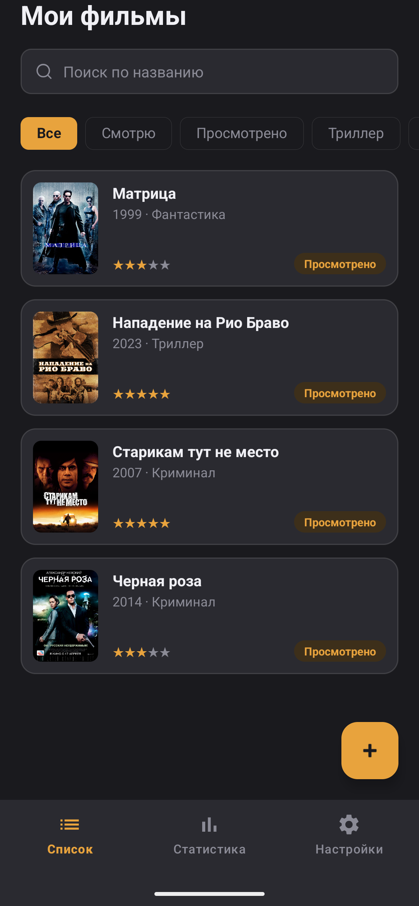
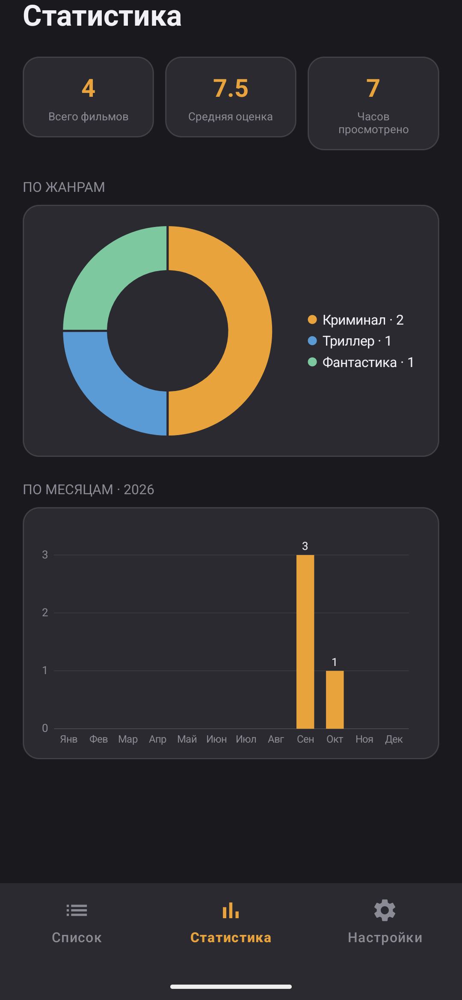

# MovieDiary

Android-приложение: личный дневник фильмов с оценками, рецензиями и статистикой. Данные фильма подтягиваются из Кинопоиска одним нажатием.

[Сайт](https://<логин>.github.io/MovieDiary/) · [Скачать APK](https://github.com/Toto-glitch/MovieDiary/releases/tag/v1.0.0)

<p align="center">
  
  
  
  
</p>

## Возможности

- Список фильмов с постерами, поиском, фильтрами по статусу и жанру, сортировкой
- Добавление и редактирование: оценка 1–10, теги, рецензия, дата просмотра, длительность
- Автозаполнение из Кинопоиска: год, длительность, постер, жанр
- Статистика: диаграммы по жанрам и оценкам
- Тёмная и светлая темы, экспорт данных в JSON
- Работает без интернета (сеть нужна только для поиска в Кинопоиске)

## Запуск

1. Откройте проект в Android Studio и дождитесь синхронизации Gradle.
2. Получите бесплатный ключ на [kinopoiskapiunofficial.tech](https://kinopoiskapiunofficial.tech/).
3. Добавьте его в файл `local.properties` в корне проекта:
   ```properties
   KINOPOISK_API_KEY=ваш_ключ
   ```
4. Запустите на эмуляторе или телефоне (Android 7.0+).

Без ключа приложение работает, но поиск в Кинопоиске покажет подсказку о том, что ключ не задан.

## Технологии

Kotlin · XML Views · Fragments · MVVM · Room · Retrofit · Coil · MPAndroidChart
